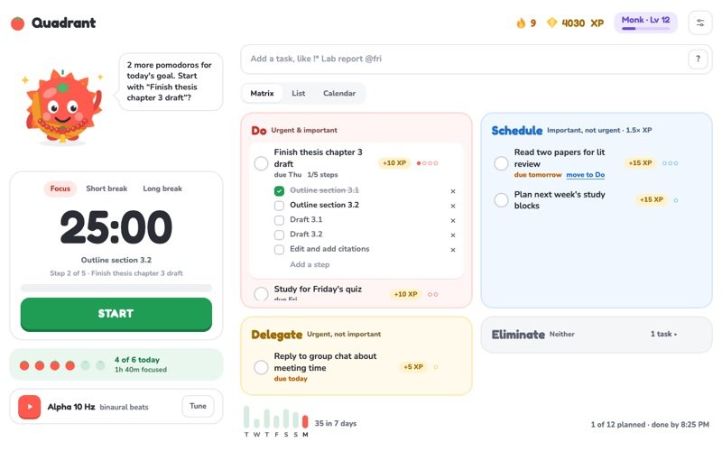

# Quadrant Focus

A pomodoro timer, an Eisenhower matrix, and binaural beats on one page, with a small tomato named Pom to keep you company.

Use it at [focus.gmpl.dev](https://focus.gmpl.dev).



I wanted three things in one place: the simple timer of [Pomofocus](https://pomofocus.io), an Eisenhower matrix for deciding what deserves my pomodoros in the first place, and binaural beats for when I need help settling in. Most tools give you one of these. Quadrant Focus puts them on a single page, and Pom makes the long study sessions feel a little less lonely.

## How it works

You sort tasks into four quadrants. Do is urgent and important. Schedule is important but not urgent. Delegate is urgent but not important. Eliminate is neither, so it stays folded into a thin strip at the bottom.

Click a task to focus on it, then press Start. Each finished pomodoro fills one of that task's dots, so you can see how your estimate compares with what the work took. While a pomodoro runs, everything except Pom, the timer and the task you picked fades back. Breaks turn the page sky blue and suggest something small to do, like refilling your water.

The timer follows the usual rhythm: 25 minutes of focus, a 5-minute break, and a 15-minute break after every fourth pomodoro. You can change all of these in Settings.

## Pom, XP and streaks

Pom is a little tomato who sits beside the timer and reacts to what you do. It waves while it waits, puts on a headband while you focus, cheers when you finish something, and wears sunglasses on breaks. It gets worried when a task is overdue or your streak is about to end, sleepy after 11 PM, and a little sheepish if you pause early. That last one is a shrug, not a guilt trip.

Finishing things earns XP. A minute of focus is worth 1 XP, so a full pomodoro is 25. A task is worth 10 in Do, 15 in Schedule, and 5 in Delegate or Eliminate, and each step is worth 2. Schedule pays more on purpose: the point of the Eisenhower matrix is to get to important work before it turns urgent, so the game should reward that. Untick something and its XP goes back.

XP adds up to levels, and the header shows your streak, which is the number of days in a row with at least one pomodoro. Under the timer, a row of tomatoes tracks your daily goal, six pomodoros by default. When a pomodoro ends, Pom celebrates with your XP, your goal and your streak, then reminds you of the next step for after your break. Below the tasks, a small chart shows the last seven days. It is a good feeling to see how much work you have done, so I wanted that in plain view.

## Pom's path

Pom is a tomato from day one, and it trains as you level up. I wanted the avatar to show how well someone can focus, which feels like a rare skill these days, so each form is something you earn by putting in the hours:

| Form | Level | Roughly when | What changes |
|---|---|---|---|
| Wanderer | 1 | day one | A straw hat and a long road ahead |
| Student | 3 | 2 days | A training gi, a headband and a belt |
| Monk | 10 | 2½ weeks | A saffron robe and cherry-tomato prayer beads |
| Master | 15 | 6 weeks | Leafy brows, a beard and a staff |
| Sage | 25 | 3½ months | Floats on a cloud with a halo of leaves |
| Ascended | 40 | 9 months | Glowing gold, on a lotus |

The times assume about six pomodoros a day. A new form takes weeks, so Pom also picks up small upgrades in between: the belt goes from white to yellow, green and black, the monk gains two beads each level, the staff sprouts leaves, and the sage's halo fills in one leaf at a time. Each new form gets its own celebration.

Two other things change Pom's look. Your streak lights an aura of flames behind it, starting at 3 days and changing color at 7, 14, 30 and 100. Miss a day and only the aura goes out, so one bad day never undoes weeks of work. Today's pomodoros set Pom's energy, so it glows and sparkles as you get close to your daily goal and past it.

Click Pom to see its path: where it is now, what comes next, and the forms still ahead as shadows. The last one stays a secret until you get there. From there, Share my Pom saves a picture of Pom with your level, streak, hours focused and pomodoros, sized for Instagram and group chats. The picture is made in your browser, so nothing is uploaded unless you post it yourself.

Pom's moods sit on top of all this, so a Master still gets worried about an overdue task.

## Adding tasks

There is one box for adding tasks. A few characters at the start decide where a task goes:

| You type | It goes to |
|---|---|
| `!* Submit scholarship form` | Do |
| `* Read two papers` | Schedule |
| `! Reply to group chat` | Delegate |
| `- Reorganize desktop icons` | Eliminate |
| `Plan next week` | Schedule |

End a task with `~3` to estimate three pomodoros. You can also drag tasks between quadrants, or hover over one and use the ⋯ menu.

## Steps

Big tasks are easier to start when they are broken into small pieces. When you focus a task, its checklist unfolds right under it, and you can keep adding steps by pressing Enter. The timer then shows the next step, like "Outline section 3.2", with "Step 2 of 5" and the task name underneath. Other tasks show a quiet count such as "1/5 steps". Once every step is ticked off, the app asks if the task itself is done.

## Due dates

Add a date anywhere in the task with `@`: `@today`, `@tomorrow`, `@fri`, `@nov12`, or `@12` for the 12th of the month. `!* Submit scholarship form @fri ~2` goes to Do, is due Friday, and is estimated at two pomodoros. You can also set or clear a date from the ⋯ menu.

Tasks sort by deadline within each quadrant. A date due today or tomorrow is tinted, and an overdue one turns red. When something in Schedule is due within a day, it offers to move to Do. In the Eisenhower matrix, a close deadline is what turns important work into urgent work, so I wanted the app to say so.

## Other views

The matrix is good for deciding what matters, but sometimes you just want to see everything at once. Above the tasks, you can switch between three views. Press `V` to cycle through them.

- **Matrix** is the Eisenhower matrix described above.
- **List** puts every open task in one column, grouped by when it is due: overdue, today, tomorrow, the next seven days, later, and no date. A small label under each task tells you which quadrant it belongs to.
- **Calendar** shows a month of deadlines. Click a day to see its tasks underneath, or press + there to add a task due that day. Tasks without a date sit in a tray below, and you can drag any task onto a day to give it that date. On a phone, tasks show up as dots.

## Exporting to your calendar or Notion

Settings has three ways to get your tasks out of the app:

- **Calendar file (.ics)** turns every open task with a due date into an all-day event. Import it into Google Calendar (Settings, then Import & export) or open it with Apple Calendar.
- **Spreadsheet (.csv)** has one row per task, with its quadrant, due date, status, estimate and steps. Notion can import it as a database, and so can any spreadsheet app.
- **Copy as Markdown** copies a checklist grouped by quadrant. Paste it into a Notion page, and it turns into to-do blocks.

These are one-time exports, not a live sync. The app has no server, so it cannot keep your calendar or Notion up to date on its own.

## Binaural beats

The player sends a slightly different tone to each ear. Your brain hears the difference as a slow pulse: 10 Hz for alpha, 18 Hz for beta, and so on. You need headphones for this to work. On speakers, it is just a hum. Under Tune, you can pick a preset, adjust the tones, add pink or brown noise, and have the beats play only while a pomodoro is running.

Frankly, the research on whether binaural beats help focus is mixed. I treat them like a good playlist: if they help you settle in, use them. If they don't, the brown noise is right there.

## Your data stays in your browser

There is no account and no server. Tasks, settings, XP, and your pomodoro history are saved in your browser's local storage, so they stay on one device and in one browser. Clearing your site data, or opening the page in a private window, starts you from scratch.

## Keyboard shortcuts

`Space` starts or pauses the timer, `S` skips to the next session, `B` turns the beats on or off, and `V` switches to the next view.

## Running it yourself

The whole app is one HTML file with no dependencies, so there is nothing to install. To run it locally:

```bash
python3 -m http.server
```

Then open http://localhost:8000.

The source lives in `src/app.html`. After editing it, run `python3 build.py`, which wraps it into the full `index.html` that gets served, and commit both files. The live site redeploys on Vercel whenever `main` changes, but any static host will do.

## Contributing

Issues and pull requests are welcome. I only ask that changes keep two things true: the page stays simple, and Pom encourages you without ever nagging.

## License

MIT. Quadrant Focus is inspired by Pomofocus but is not affiliated with it.
