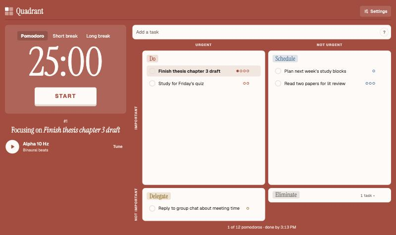

# Quadrant Focus

A pomodoro timer, an Eisenhower matrix, and binaural beats on one quiet page.

Use it at [quadrant-focus.vercel.app](https://quadrant-focus.vercel.app).



I wanted three things in one place: the simple timer of [Pomofocus](https://pomofocus.io), an Eisenhower matrix for deciding what deserves my pomodoros in the first place, and binaural beats for when I need help settling in. Most tools give you one of these. Quadrant Focus puts them on a single page and then tries hard to stay out of the way.

## How it works

You sort tasks into four boxes. Do is urgent and important. Schedule is important but not urgent. Delegate is urgent but not important. Eliminate is neither, so it stays folded into a thin strip at the bottom.

Click a task to focus on it, then press Start. Each finished pomodoro fills one of that task's dots, so you can see how your estimate compares with what the work took. When a session ends, a short card tells you what you just spent 25 minutes on before the break begins. While a pomodoro runs, everything except the task you picked fades back.

The timer follows the usual rhythm: 25 minutes of focus, a 5-minute break, and a 15-minute break after every fourth pomodoro. You can change all of these in Settings.

## Adding tasks

There is one box for adding tasks. A few characters at the start decide where a task goes:

| You type | It goes to |
|---|---|
| `!* Submit scholarship form` | Do |
| `* Read two papers` | Schedule |
| `! Reply to group chat` | Delegate |
| `- Reorganize desktop icons` | Eliminate |
| `Plan next week` | Schedule |

End a task with `~3` to estimate three pomodoros. You can also drag tasks between boxes, or hover over one and use the ⋯ menu.

## Binaural beats

The player sends a slightly different tone to each ear. Your brain hears the difference as a slow pulse: 10 Hz for alpha, 18 Hz for beta, and so on. You need headphones for this to work. On speakers, it is just a hum. Under Tune, you can pick a preset, adjust the tones, add pink or brown noise, and have the beats play only while a pomodoro is running.

Frankly, the research on whether binaural beats help focus is mixed. I treat them like a good playlist: if they help you settle in, use them. If they don't, the brown noise is right there.

## Your data stays in your browser

There is no account and no server. Tasks and settings are saved in your browser's local storage, so they stay on one device and in one browser. Clearing your site data, or opening the page in a private window, starts you from scratch.

## Keyboard shortcuts

`Space` starts or pauses the timer, `S` skips to the next session, and `B` turns the beats on or off.

## Running it yourself

The whole app is one HTML file with no dependencies, so there is nothing to install. To run it locally:

```bash
python3 -m http.server
```

Then open http://localhost:8000.

The source lives in `src/app.html`. After editing it, run `python3 build.py`, which wraps it into the full `index.html` that gets served. I deploy the live site to Vercel with `vercel --prod`, but any static host will do.

## Contributing

Issues and pull requests are welcome. I only ask that changes keep the page quiet. Most of the recent work on this went into taking things out rather than adding them, and I would like to keep it that way.

## License

MIT. Quadrant Focus is inspired by Pomofocus but is not affiliated with it.
